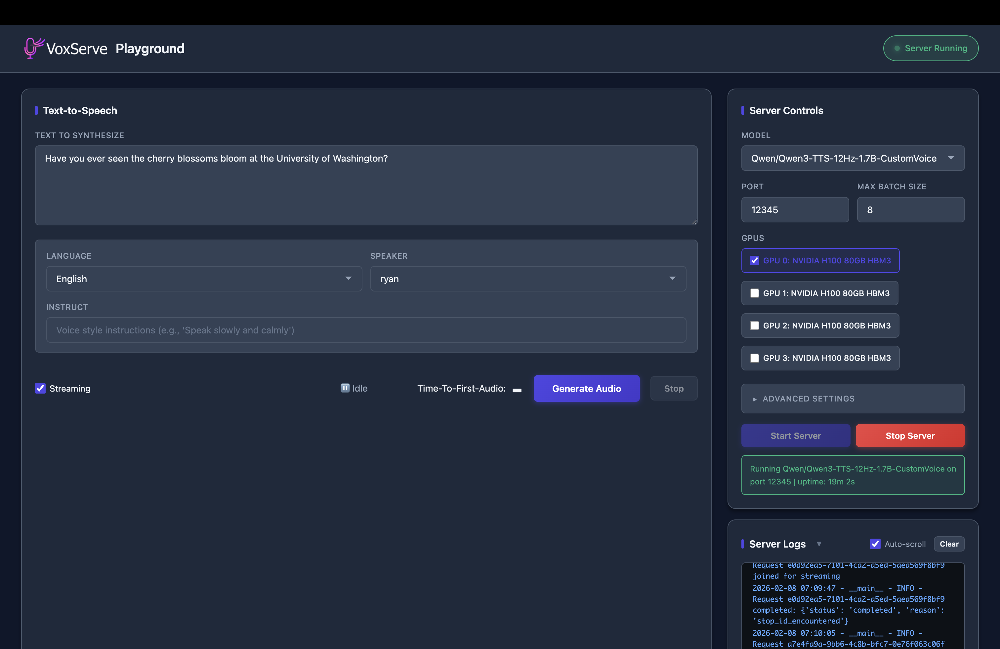

# VoxServe Playground

A web-based playground for interacting with VoxServe TTS server. Start the server, send requests, and play back generated audio with real-time latency metrics.



## Features

- **Server Management**: Start and stop VoxServe server with configurable parameters, on the Rust (default) or Python runtime
- **GPU Selection**: Choose which GPUs to use via `CUDA_VISIBLE_DEVICES`
- **Model Selection**: Support for all VoxServe models including all Qwen3-TTS variants
- **Server Logs**: Real-time log display with syntax highlighting
- **Streaming Playback**: Real-time audio playback with Web Audio API
- **Stream Text**: Send text word by word through the input-streaming API at an adjustable speed (as an LLM would), with first-audio latency and playback stalls
- **Latency Metrics**: Display time-to-first-audio (TTFA) for both network and playback
- **Proxy Architecture**: All requests routed through the playground backend

## Usage

Start the playground server by running the following command in the playground directory:

```bash
cd examples/playground
python app.py --port 7860
```

Open http://localhost:7860, pick a model and runtime, and press **Start Server**.

## Input streaming

The **Stream Text** and **LLM Chat** tabs use `/generate/stream/{start,text,end}`.

- On the **Rust runtime** every scheduler serves both normal and input-streaming requests. Async scheduling, repetition window, NVTX and disabling CUDA graphs are Python-only, so they are disabled for it.
- On the **Python runtime**, input streaming needs the `input_streaming` scheduler, which then serves only input streaming.
- `bosonai/higgs-tts-3-4b` streams on the Rust runtime only. It reads the text in clause-sized turns, so slow text pauses at clause ends. Reference audio (and optionally its transcript) clones a voice. Every turn stays in context: raise **Max Context** in the advanced settings for streams longer than about a minute.
